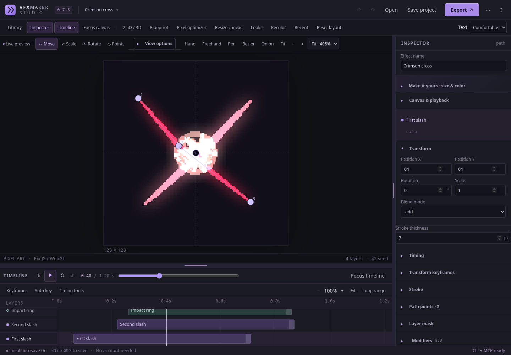
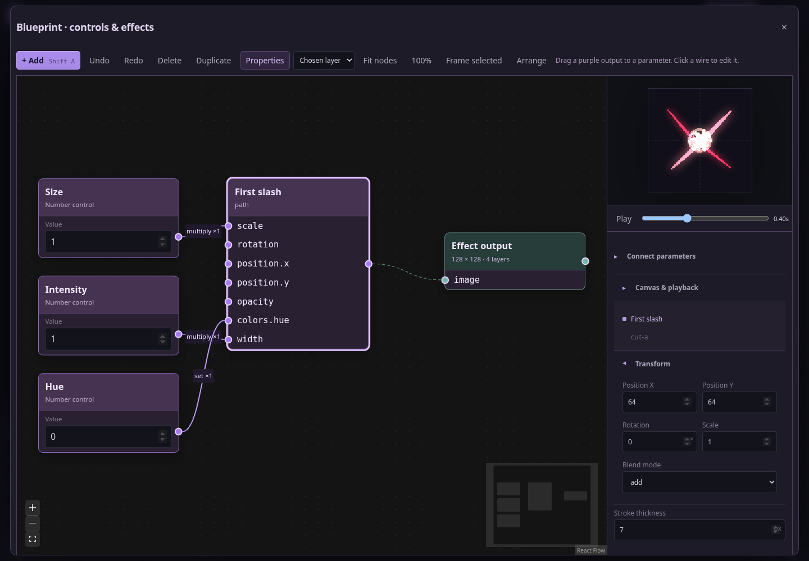
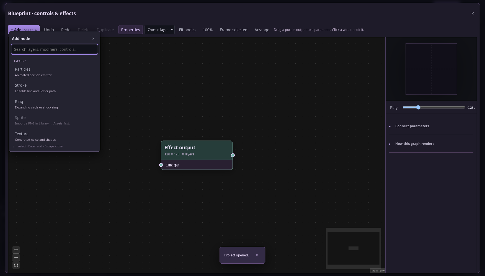
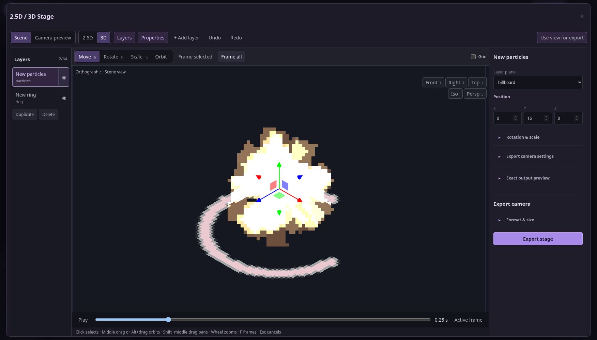
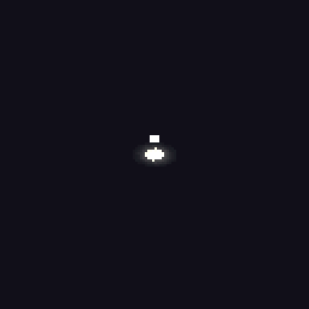
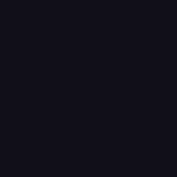
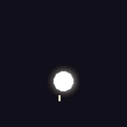
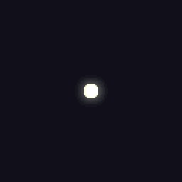
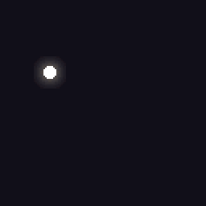
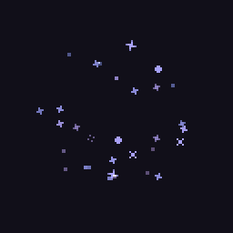

# VFX Maker 0.7.5 — AI-native pixel VFX studio

**Draw and customize effects in a visual editor. Let an AI agent use the same tools through MCP.**
Built with TypeScript, PixiJS 8 and React 19. MIT licensed, local, and usable from
any game/project folder. The browser editor, Terminal and MCP share validated
project operations and the same renderer.

**0.7.5:** searchable **Add** creates real layers, modifiers and controls in
Blueprint. Scene editing has native-resolution handles, an outliner, alpha picking,
Move/Rotate/Scale gizmos, orbit/pan/zoom and a separate exact camera preview.
2D remains the canvas-first default.
[Release notes](docs/RELEASE_0.7.5.md) · [Blender interaction research](docs/RESEARCH_0.7.5.md).



<details>
<summary>Detailed Blueprint workspace</summary>



</details>

<details>
<summary>Built from an empty file through the actual UI</summary>




[Step-by-step screenshots, editable project and exported GIF](examples/workspaces/README.md).

</details>

## AI-native, with results an agent can verify

MCP exposes **41 tools**: discovery and schemas, editable projects, layer/path
operations, Blueprint ports and connections, annotated PNG previews, exact canvas
coordinates, dry-run transactions, revisions/backups, independent project batches,
render budget preflight, numeric RGBA parity/baselines and game exports.

A practical workflow is **capabilities → new_project → get_node_catalog / get_blueprint /
observe_project → preview edits → apply_edits → analyze_project → export**.
Agents can edit the same parameters and paths as a person, then open the resulting
`.vfx.json` in Studio. Image resources can be read/saved when a host omits inline
images; an agent must report that limitation rather than claiming to have seen a preview.

This is a local authoring tool for external MCP clients; Studio does not contain a
hosted AI model or chat service. [MCP setup and examples](docs/MCP.md) ·
[Shared Blueprint operations](docs/BLUEPRINT.md) ·
[Real catalog MCP example, transcript and QA](examples/catalog-agent/README.md).

## Optional 2.5D / 3D Stage

**2D remains the default editor.** Open **2.5D / 3D** to place effect layers in a
scene. Select from the outliner or click visible effect pixels. Use **G / R / S**
or the Move/Rotate/Scale buttons and drag an axis handle. **Escape** cancels a
transform; Undo restores it. Middle-drag or Alt+drag orbits, Shift+middle-drag pans,
and wheel zooms. **F** frames selected, Shift+F frames all.

Scene navigation is independent from the saved output camera. **Use view for
export** aligns that camera; **Camera preview** displays its actual output pixels.
Grid starts off. A native-resolution editing canvas keeps handles clear; exports
keep their chosen pixel resolution. Layer position, rotation and independent axis
scale are editable and saved.

This stage projects animated effect planes through a real camera. Game outputs
are baked GIF/PNG/atlases; volumetric particles and mesh exports are outside its
scope. [Stage guide](docs/STAGE.md) · [Camera examples](examples/stage/README.md).

<details>
<summary>Camera-stage GIF examples</summary>

| Isometric healing field                                         | Crimson cross in depth                                                                 |
| --------------------------------------------------------------- | -------------------------------------------------------------------------------------- |
|  |  |

[Open editable projects](examples/stage/README.md).

</details>

## Showcase

Actual GIFs exported by VFX Maker. Each caption opens its editable project.

| Crimson cross                                                 | Void portal                                            | Ember plume                                            |
| ------------------------------------------------------------- | ------------------------------------------------------ | ------------------------------------------------------ |
|  |       |       |
| [Edit project](examples/showcase/red_magic_cross.vfx.json)    | [Edit project](examples/showcase/void_portal.vfx.json) | [Edit project](examples/showcase/ember_plume.vfx.json) |

| Electric bloom                                            | Glacial lance                                        | Healing pulse                                         |
| --------------------------------------------------------- | ---------------------------------------------------- | ----------------------------------------------------- |
|    |     |     |
| [Edit project](examples/showcase/electric_bloom.vfx.json) | [Edit project](examples/showcase/ice_lance.vfx.json) | [Edit project](examples/showcase/heal_pulse.vfx.json) |

| Lightning                                            | Comet                                            | Stardust                                            |
| ---------------------------------------------------- | ------------------------------------------------ | --------------------------------------------------- |
|         |             |          |
| [Edit project](examples/showcase/lightning.vfx.json) | [Edit project](examples/showcase/comet.vfx.json) | [Edit project](examples/showcase/stardust.vfx.json) |

## Run

For people using Studio: download **vfx-maker-0.7.5-studio.zip** from the
[release](https://github.com/mychicken0/VFX_maker/releases/tag/v0.7.5), extract it,
and open **Start VFX Maker.cmd** on Windows or **Start VFX Maker.command** on macOS.
On Linux run `./Start-VFX-Maker.sh` (or `node launch.mjs`). Install **Node.js 24 LTS**
once first. The first launch installs dependencies locally; subsequent launches
open Studio in your browser. Keep the launcher Terminal running while editing.
These are Node launchers, not a bundled desktop binary; Windows/macOS scripts
have not been tested on those operating systems.

**Updating:** stop the old Studio Terminal, then open Start from the newly
extracted 0.7.5 folder. Import your saved project or use connected Open/Save.
When reusing a launcher folder, it checks the installed version before starting.

Requires **Node 22.18+** (Node 24 recommended). From source:

```bash
npm ci
npm run build
node dist/cli.js studio --open
```

Or install the prepared `vfx-maker-0.7.5.tgz` once and use it in any folder:

```bash
npm install -g /path/to/vfx-maker-0.7.5.tgz
cd /path/to/your/game
vfx studio --open
```

Source installer: `bash /path/to/VFX_maker/scripts/install.sh /path/to/tools`;
add `/path/to/tools/bin` to PATH. The installed package includes the built editor
and renderer; it does not need this checkout or a game repository.
This package has not been published to the npm registry.

**Browser:** Studio runs in a modern browser with WebGL2. CLI/MCP rendering uses
local Chrome/Chromium through Playwright. Discover it with `vfx doctor`, or use
`vfx browser install` / `VFX_CHROMIUM_PATH=/absolute/path/to/chromium`.
On Linux, install the browser's normal system libraries as well. No API key,
account or network connection is needed after installation. Linux/Chromium is
tested; macOS, Windows, Firefox and Safari are not verified.

## Customize visually

- The canvas fills available space; **Focus canvas** hides panels for more room. **Library** starts closed; open it for Effects,
  layers and assets. **Make it yours** and advanced options start folded.
- Use **Move / Scale / Rotate** on the canvas. Wheel zooms at your cursor, middle
  drag pans, **F** fits; **V / S / R / P** select transform/point tools. Shift when
  starting a rotation snaps it to 15° increments.
- **Pen** places points; Enter or double-click finishes, Escape cancels. **Points**
  inserts/deletes/smooths anchors and edits coordinates. Inspector curve points
  can be dragged in time/value; each completed drag is one undo.
- Drag the thick timeline divider to resize, **+ / −** to zoom time, **Fit** to
  reset horizontal zoom and **Focus timeline** to expand it. Text size is adjustable.
- Open **Make it yours · size & color** for Size / Intensity / Hue. Recolor can set
  real gradients, including gray smoke. Detailed bindings stay folded.
- Add **Modifiers** to a layer: outline, pixel blocks, color replacement/ramp,
  shockwave, noise warp or dissolve. Reorder or bypass steps independently.
- Save selected layers under **Saved**, then insert them into another project.
  Download/import portable components with their textures and controls.
- Save **Looks** to compare control/seed variations and export selected looks as
  a batch. They share the same effect structure.
- Open **Keyframes → All channels** for multi-key editing, copy/paste and
  frame-snapped moves. **Auto key** records transform changes at the playhead;
  **Timing tools** stretches the effect or staggers a selection.
- Generate noise/cells/shapes without importing a texture, emit particles from
  visible PNG pixels, or enable sampled particle trails.

- Start with one of **22 editable effects**, or add particles, strokes, rings,
  sprites and procedural textures. Drag layers to change compositing order; hide, lock or duplicate.
- Drag the viewport's center handle to move a layer. Drag numbered stroke
  points to reshape it; double-click to add a point.
- Ctrl/⌘-click or Shift-click to select layers, then group them. Move the
  selection in the canvas or apply translation, rotation, scale, blend and opacity
  together. Locked layers are skipped unless explicitly included.
- Draw **Freehand** strokes or enable **Bezier** tangents on existing strokes.
  Layer masks clip to a rectangle, ellipse or editable polygon, including glow.
- Move and resize timeline clips. Open **Keyframes**, choose a channel and
  double-click/drag keys directly; frame snapping, numeric values and easing are
  editable. Use **Onion** for adjacent frames and **Loop range** for a work area.
- Import a character or scene under **Reference**, then position it, change its
  scale/opacity and place it behind or above the effect. It remains preview-only.
- Edit color stops and curves for opacity, size, draw progress and geometry.
  Transform keyframes animate X/Y offsets, rotation and scale.
- Import PNG textures or flipbooks. Set columns/rows/frame count; textures are
  embedded in the portable `.vfx.json` project.
- Fit the canvas, pan with Hand or middle mouse, zoom around the pointer with
  Ctrl/⌘ wheel, and toggle pixel grid or snapping. Panels resize, collapse and
  remember their layout; narrow windows use side drawers.
- Recolor all or selected layer gradients/tints together, with a real preview
  and one-step undo. Locked layers are skipped by default.
- Resize the composition uniformly to fit a new canvas, or crop/expand only
  the canvas. Raise/lower, solo-preview, search and keyboard-nudge layers.
- Open **Pixel optimizer** to compare a frame or PNG before/after. Recompress
  losslessly, reduce colors/alpha levels, resize with nearest-neighbor sampling,
  or make larger pixel blocks. Download PNG, replace a texture or reuse the
  settings on every export format. Actual byte savings are shown.
- Undo/redo with Ctrl/⌘ Z and Ctrl/⌘ Shift Z. Browser autosave restores recent
  edits after a close; **Recent** retains eight project snapshots. **Save** writes
  a connected disk file, **Save As** changes the target, and **File backups**
  restores one of the last five distinct file versions.
- Export GIF, transparent PNG sequence, padded spritesheet, Godot SpriteFrames
  or Unity import folder directly from Studio. Output scale works in every
  format; atlas padding and optional edge extrusion support game textures.
  Palettes are shared across animation frames. Export ZIPs include the project.

**Saving:** `vfx studio file.vfx.json` connects Save to that file with SHA-256
revision checks and backups in its `.vfx-backups` directory. Chromium browsers
can also remember a file chosen with the native Open/Save As picker; backups go
to IndexedDB. Other browsers fall back to file import/download. **Project menu →
Download project** always creates a portable copy. Recovery offers unsaved work
or the disk version when reopening a connected document. Browser storage and
remembered handles are specific to the profile and origin/port, and can be
removed by clearing site data. See [saving and authoring](docs/STUDIO.md).

## Terminal

```bash
vfx new slash.vfx.json --preset red_magic_cross --seed 42
vfx studio slash.vfx.json --open
vfx set slash.vfx.json --layer cut-a --set '{"position":{"x":70}}'
vfx preview slash.vfx.json --time 0.4 --out preview.png
vfx export slash.vfx.json --format gif --scale 3 --out slash-gif --progress
vfx export slash.vfx.json --format godot --scale 0.5 --out slash-godot
vfx optimize preview.png --out small.png --colors 16 --scale 0.5
vfx resize slash.vfx.json --width 64 --height 64
vfx recolor slash.vfx.json --hue 120
vfx group slash.vfx.json --id attack --name Attack --layers cut-a,cut-b
vfx transform slash.vfx.json --layers cut-a,cut-b --x 4 --scale 0.8
vfx keyframe slash.vfx.json cut-a motion.x --time 0.5 --value 12 --ease smooth
vfx backups slash.vfx.json
vfx observe slash.vfx.json --view storyboard --out inspection
vfx gradient slash.vfx.json --color '#804cff'
vfx preflight slash.vfx.json --options '{"format":"gif","scale":2}'
vfx analyze slash.vfx.json --out baseline.json
vfx batch --tasks-file tasks.json --dry-run
vfx edit slash.vfx.json --edits-file edits.json --if-match REVISION --dry-run
```

See the [rendered sword GIF](examples/red-magic-cross.gif).

Use `vfx presets`, `vfx schema layer` and `vfx --help` to explore. Commands return
JSON; progress goes to stderr. Files live inside `--root` (defaults to cwd).
Output names must be unused; parent folders must exist. Edits validate before
publication, use an exclusive file lock and atomic replacement, and support
`--if-match REVISION` from `inspect`. MCP mutations require that revision.

## Write your own effect in TypeScript

```ts
import { defineEffect, path, curve, colors } from "vfx-maker";

export default defineEffect({
  name: "My slash",
  layers: [
    path({
      id: "cut",
      name: "Blade trail",
      points: [
        { x: -40, y: 30 },
        { x: 0, y: -10 },
        { x: 40, y: -30 },
      ],
      width: curve(8, 4, 0),
      colors: colors("#ffffff", "#ff2459"),
      glow: { strength: 1.4, blur: 3 },
    }),
  ],
});
```

```bash
vfx build my-effect.ts --out my-effect.vfx.json
vfx studio my-effect.vfx.json --open
```

`build` executes **trusted local TypeScript**, with normal Node access. It is
not exposed as an MCP tool. Modules can generate shapes, parameters and layers
using ordinary code; saved projects contain data and can be opened without
executing code. See [customization](docs/CUSTOMIZATION.md) and the runnable
[Bezier/mask/group example](examples/bezier-slash.ts).

## Codex / Claude through MCP

```bash
codex mcp add vfx -- /absolute/path/to/vfx-mcp --root /path/to/effects
```

For clients with `mcpServers`, merge this entry into their settings:

```json
{
  "mcpServers": {
    "vfx": {
      "command": "/absolute/path/to/vfx-mcp",
      "args": ["--root", "/path/to/effects"]
    }
  }
}
```

41 tools cover templates, schemas, portable projects, layer/group transforms,
keyframes, backups and restoration, direct layer updates,
embedded assets, inline image previews, PNG optimization, canvas resizing,
recoloring, ordered modifiers, macro controls, components, variants, exports and
cancellable background jobs. The official MCP SDK is used; stdout carries only the protocol.
Start with `observe_project`, preview proposed changes using its `edits` field,
then commit with `apply_edits`. Observations include a real image, stable layer
IDs, pixel bounds, timing and point picks. Hosts that hide images can read PNG
resources or use `save_preview` with a local image viewer. A tool cannot add
vision to a text-only model. Read the [agent workflow and host setup](docs/MCP.md).
Use `batch_projects` for independent files, `set_gradient` for exact source
colors, `preflight_export` for budgets and `analyze_project` for per-frame
RGBA hashes, reverse-order parity and saved baseline comparisons. A completed
batch reports each file independently; successful files are retained on partial failure.


[Earlier visual workflow example](examples/agent-workflow/README.md) ·
[0.7.3 batch, direct-color and QA examples](examples/workflows-0.7.3/README.md).

## Development

```bash
npm run dev           # Vite + React hot reload
npm run typecheck
npm test             # simulation, validation, storage and jobs
npm run build
npm run test:e2e      # actual Chromium UI/pixels/exports/CLI/MCP
npm run format:check
```

Set `VFX_CHROMIUM_PATH` for browser tests when needed. CI installs Playwright
Chromium and its Linux dependencies. `scripts/render-gallery.mjs` produces a
full local gallery using the actual Pixi renderer.

## Pixel output and research

Default PNG recompression preserves decoded RGBA and keeps the original encoding
when it is smaller. Palette, alpha, block and scale changes are lossy; the UI
labels them explicitly. GIF uses an opaque matte. PNG input is static, up to
1024 × 1024 and 4 MiB; embedded assets are limited to 1 MiB. Compressed metadata,
16-bit PNG and non-sRGB gamma are rejected by the optimizer. Metadata may be
stripped during recompression. PNG optimization does not require Chromium.

See [pixel workflows](docs/PIXEL_WORKFLOWS.md),
[open source/product references](docs/OPEN_SOURCE_RESEARCH.md),
[0.7.3 workflow improvements](docs/RELEASE_0.7.3.md),
[0.7.2 agent tools](docs/RELEASE_0.7.2.md),
[0.7.1 UI fixes](docs/RELEASE_0.7.1.md),
[0.7.0 features](docs/RELEASE_0.7.0.md),
[validation](docs/VALIDATION_0.7.5.md),
[previous authoring release](docs/RELEASE_0.6.0.md), and
[project compatibility](docs/MIGRATION.md).

## License

VFX Maker application code is [MIT licensed](LICENSE). Dependencies retain their
own licenses; see [third-party notices](THIRD_PARTY_NOTICES.md).
