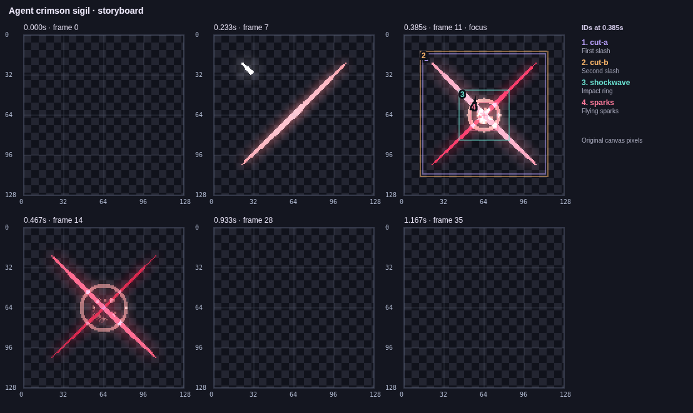

# VFX Maker 0.7.2

Agents could already request a clean PNG, but lacked a useful description of
where its parts were, which controls changed them and why a chosen frame was
empty. This release adds an observe, preview, commit and verify workflow to the
portable CLI/MCP package.

- **`observe_project`** returns a real annotated frame, storyboard or layer
  sheet plus structured/text coordinates, stable IDs, animated transforms,
  world path points, isolated pixel bounds, timing states and macro bindings.
  Point picks use rendered alpha, including masks. Automatic time selection
  samples a visible representative moment; explicit empty times stay explicit.
- **Drafts before saving:** supply `revision` and `edits` to observe the proposed
  result without changing disk. Images visibly say DRAFT and retain their source
  revision. The proposed revision is reported separately.
- **`apply_edits`** validates 1..64 generic operations and commits once with one
  backup. Errors roll back the entire batch. Canvas/normalized path editing
  converts points and Bezier vectors through the same animated transform as Pixi.
  Existing direct tools remain supported; 34 tools are now available.
- **Image fallbacks:** PNG resource URIs carry hashes, dimensions, revision and
  draft status. `save_preview` writes a fresh root-scoped PNG for a host viewer.
  `includeImage:false` keeps scene metadata/resources; large replies can also
  omit the inline payload with an explanation. Clean PNGs exclude guides and
  references and agree with exported pixels.
- **Guidance:** server instructions, `vfx://guide`, `effect_workflow` prompt,
  actionable domain errors, host setup examples and a real reproducible MCP task.
  Studio explains the workflow inside Help; artist controls stay in place.
- **Terminal:** `vfx observe` publishes inspection images and `scene.json`;
  `vfx edit --edits-file` applies the same operation array with optional dry run.
  `vfx preview` can choose a representative time when `--time` is omitted.
- Projects/components from 0.7.1 remain readable. Reading does not overwrite them;
  saving writes 0.7.2.

[Editable example and protocol replay](../examples/agent-workflow/README.md) ·
[Host setup and complete tool guide](MCP.md) · [Validation](VALIDATION_0.7.2.md)

MCP delivery does not guarantee a host passes images to its model. Nonvision
models can use coordinates and bounds, but cannot visually judge the result.
Automatic timing is a bounded search, not an exhaustive animation scan; layer
sheets show nine scoped layers and report omitted IDs. Image resources and job
states are session-local. This release is verified through protocol clients,
not a benchmark of external Codex/Claude GUI sessions.
