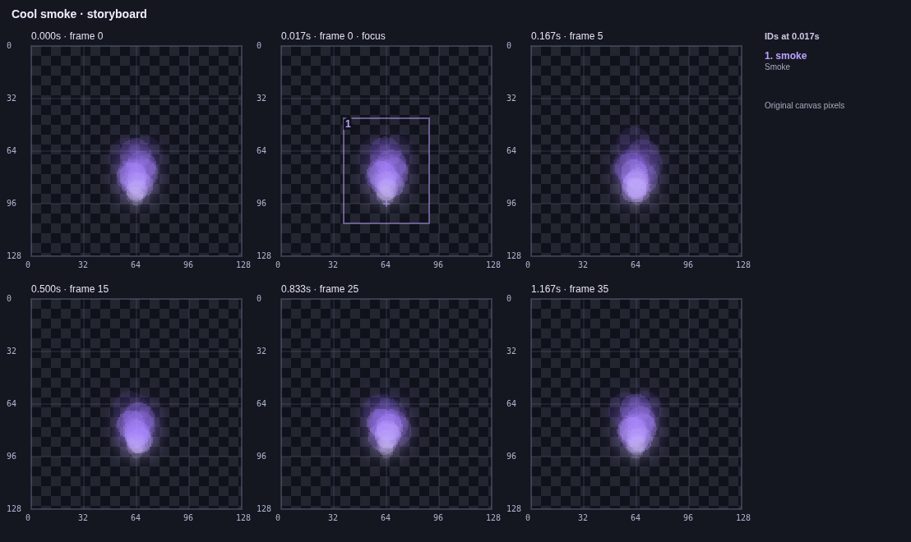

# VFX Maker 0.7.3

This release addresses multi-project authoring, direct color control, numeric
render QA, repeated MCP startup cost, empty storyboard tails and larger compositions.

- **Independent project batches:** `batch_projects` handles up to 32 create,
  revisioned edit or export tasks. Create/edit tasks can also export. Dry runs
  validate files, revisions and budgets without writing. Real runs use project-count
  jobs with per-item results. Each edited file gets one atomic commit/backup;
  successful files remain when another item fails. Partial writes and cancellation
  are reported explicitly. CLI: `vfx batch --tasks-file tasks.json`.
- **Direct colors:** `set_gradient` accepts a solid color or complete gradient
  for all/selected layers, including achromatic smoke. It is also an `apply_edits`
  operation, a CLI command and **Recolor → Set gradient** in Studio. Fully selected
  hue controls reset to neutral; mixed controls lose only the affected hue bindings.
  Embedded PNG pixels and modifier colors stay independent.
- **Numeric regression QA:** `analyze_project` / `vfx analyze` report raw straight-RGBA
  hashes, alpha/bounds/activity statistics and reverse-order rerender parity.
  Reports can be saved as fresh JSON baselines and compared later. CLI comparisons
  fail with exit code 2. Defaults cover all export frames; explicit times reduce work.
  Peak activity is reported as a measurement, not an inferred game hit event.
- **Export preflight:** `preflight_export` / `vfx preflight` expose the same validator
  used by exports, with actual usage, limits and RGBA-buffer estimates. No browser
  is needed. Export budget errors include this numeric report.
- **Warm MCP rendering:** up to two isolated workers reuse their browser, page
  and unchanged project resources. Idle workers close after 30 seconds; CLI exit
  and MCP shutdown close them explicitly. Cancelling a running render discards
  its worker without closing another request. Separate CLI invocations start cold;
  CLI batch reuses its renderer within that process.
- **Activity-focused storyboards:** default sheets choose distributed visible
  sampled moments and retain real timestamp captions. `storyboardMode:"timeline"`
  preserves full-duration context; explicit times preserve any requested blank
  frames. This changes inspection selection, not playback/export timing.
- **64 layers:** editor actions, groups, selections, components and MCP schemas
  share one limit. Control bindings support 256 entries for translated/grouped
  compositions. Independent file, particle, texture, curve-key and export budgets
  remain enforced. Existing 0.7.2 projects/components open without rewriting disk.

38 MCP tools are available. Common Studio actions stay in the existing controls;
batch/QA details live in the tools and documentation.

[Actual MCP task and measured before/after results](../examples/workflows-0.7.3/README.md) ·
[Full tool guide](MCP.md) · [Executed validation](VALIDATION_0.7.3.md)
