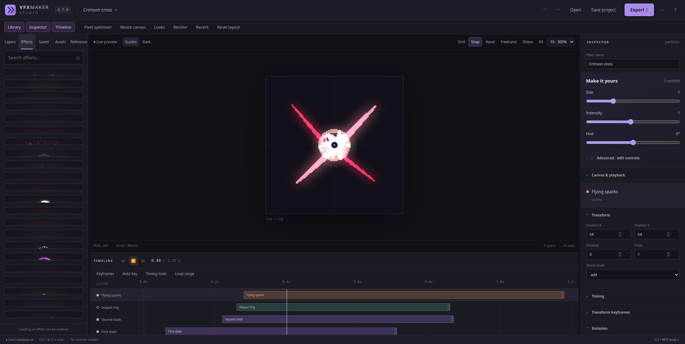
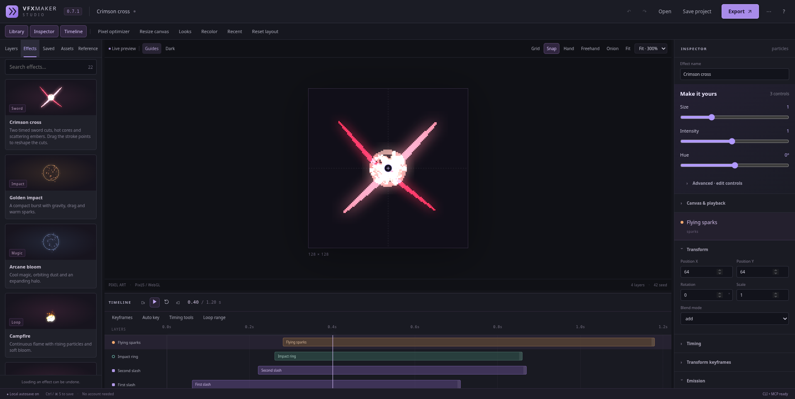
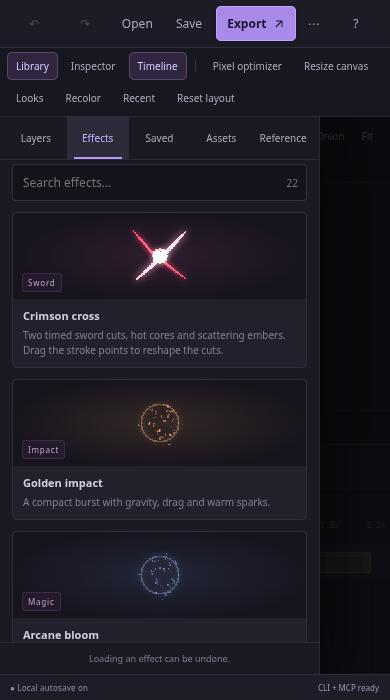
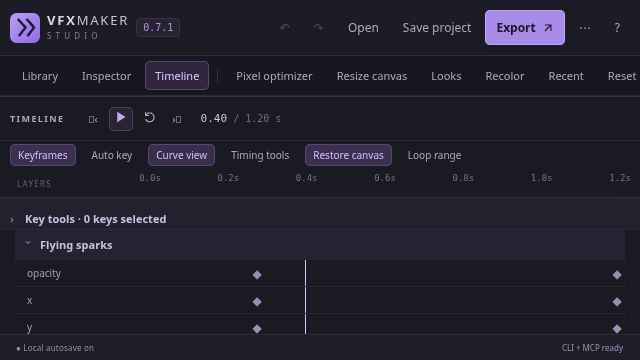

# 0.7.1 validation

Checked on 2026-10-22 with Node 24.19.0, Linux and Chromium/SwiftShader.

## Reproduction and visual checks

The supplied Effects layout was reproduced at **1917 × 963**. In 0.7.0, the
22 grid rows measured about **21.3 px** each. Their content needed 154–169 px,
but the list had no vertical overflow, so images and text were clipped.
The fix gives rows their content height and lets the list scroll.

| Before                                                                      | 0.7.1                                                                     |
| --------------------------------------------------------------------------- | ------------------------------------------------------------------------- |
|  |  |

The regression checks every card's height, image loading and text bounds, rather
than relying on Playwright's element visibility alone. It scrolls to and loads
the last template. Viewports: **1917 × 963, 1440 × 1000, 1024 × 640,
390 × 700 and 640 × 360**. Sidebar resizing is checked at both 180 and 380 px.

All five library tabs are exercised with **32 layers, 8 textures, long names and
a reference image**, including access to the last item and bottom controls.
Search checks cover one match, no matches and clearing the query.





Pixel optimizer, Resize canvas, Looks, Recolor, Recent, Timing tools, Help and
Export were also opened at desktop, narrow and short sizes. Dialog bounds and
browser errors were inspected. The optimizer's downloaded frame at 0.40 s
contains 5,510 nontransparent pixels. Crimson cross at 0.94 s contains zero:
that is its faded-out tail, not a renderer failure.

## Executed checks

- Formatting, TypeScript and production build pass.
- **56 unit tests** pass, including migration of an existing 0.7.0 project without
  losing its creative settings.
- **53 browser scenarios** pass. They include the layout regressions, native
  keyboard activation, replay/restart, undo, file Save/Save As, backups, crash
  recovery, masks, references, controls, components, modifiers, keyframes, PNG
  optimization and exact exported pixels.
- **16 scenarios** are repeated using the tarball installed under
  `/workspace/.vfx-js-tools`. The Studio server starts in a separate temporary
  directory. Twelve UI scenarios use its packaged web assets; four CLI/MCP
  workflows select its installed executables and work outside the checkout.
- All **22 templates** were rendered as GIFs and atlases. The nine README GIFs
  were regenerated; their bytes are unchanged by this UI patch. Their checked-in
  editable projects and manifest report 0.7.1.

Commands for the source checks:

```bash
npm run format:check
npm run check
node scripts/render-gallery.mjs --out /path/to/new-gallery --thumbnails --showcase
npm pack --ignore-scripts
```

Successful layout tests save screenshots under `test-results`; CI uploads that
directory as `browser-checks-0.7.1` as well as retaining traces on failure.
These checks cover Linux/Chromium. They do not establish behavior on every
browser, operating system or GPU, or replace feedback from artists using the app.
