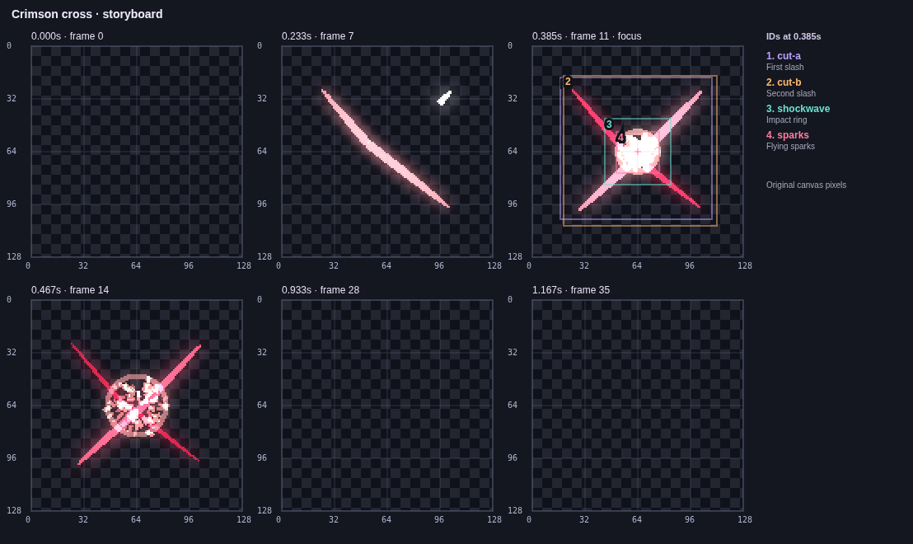
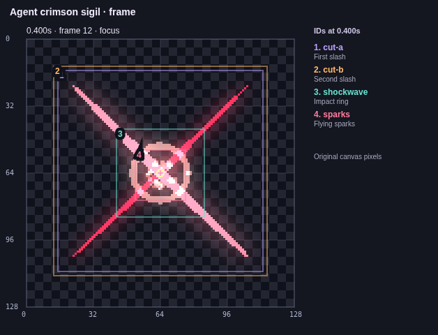

# An effect authored through MCP


This editable result was made through the official MCP SDK over stdio, using
real VFX Maker tools. During development the returned before/draft images were
opened and inspected. The first draft still obscured the center, so the final
recipe reduces particle size/opacity as well as count. Rendering uses ordinary
path, ring and particle data; no special rendering code selects this example.

| Before: sampled storyboard                | Final: coordinates and layer bounds |
| ----------------------------------------- | ----------------------------------- |
|  |      |

[Final project](effect.vfx.json) · [Edit recipe](recipe.json) ·
[Scene coordinates](scene.json) · [Draft image](draft.png) ·
[Final storyboard](storyboard.png) · [Clean PNG](clean.png) ·
[Executed checks and hashes](manifest.json)

The session created the template, observed its timing, previewed canvas-coordinate
stroke edits, validated without writing, committed once, read PNG resources,
saved previews, verified the committed frame against the draft hash and exported
a GIF through a background job. `final.png` came from the text-only observation
path followed by `save_preview`; a host does not need inline-image support to
retrieve the PNG. It still needs a vision-capable model/viewer to see that PNG.

Reproduce after building, with a fresh output directory:

```bash
node scripts/verify-agent.mjs /absolute/path/to/new-session
# Or test an installed server from an unrelated working directory:
node scripts/verify-agent.mjs /absolute/path/to/new-session /absolute/path/to/vfx-mcp
```

The script replays the inspected recipe and checks its assertions; it does not
run an external AI model. Its output includes a protocol transcript without image
base64, metadata, images, project, backup and export. To manually choose edits
between images, use `scripts/mcp-session.mjs ROOT EVIDENCE_DIRECTORY` and send
JSON lines such as `{"tool":"observe_project","arguments":{"file":"effect.vfx.json"}}`.
Use `{"resource":"vfx://guide"}` or `{"close":true}` in the same session.

The manifest records this Linux/Chromium render. Annotation font rasterization
can vary by OS. Cached resource URIs in a live session expire on eviction or
restart; archived PNGs and coordinate JSON remain usable.
