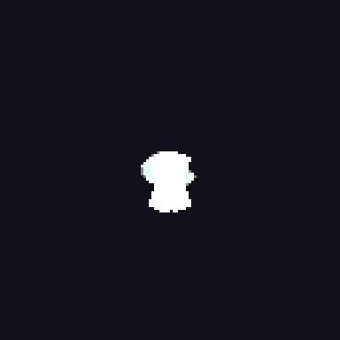

# Real catalog MCP workflow · 0.7.5



The official MCP SDK client connects over stdio and creates an empty project.
It reads **get_node_catalog**, uses its actual layer/modifier/control edit payloads,
connects Arc to a ring parameter, applies a gradient, places ground/billboard planes,
previews a no-write camera draft, commits, verifies parity and exports GIF/Godot.

- [Editable project](aura.vfx.json), [edits](edits.json), [graph](graph.json),
  [saved stage](stage.json).
- [Uncommitted draft](draft.png), [committed camera PNG](camera.png),
  [numeric QA baseline](baseline.json).
- [Actual structured transcript](transcript.json), [manifest](manifest.json).
- [Godot resource](godot/effect.tres), [atlas](godot/atlas.png).

The draft leaves source bytes unchanged. Its PNG hash matches the committed
camera PNG; reverse-order RGBA parity passes at four times. Both background
export jobs succeed. These are the same validated factories as the Studio Add
menu; no preset-specific rendering code is involved. Images were opened for
visual inspection. An external model GUI host and Godot editor import were not tested.

```bash
node scripts/verify-catalog-agent.mjs /path/to/new-session
# An installed vfx-mcp entry can be appended as the second argument.
```
