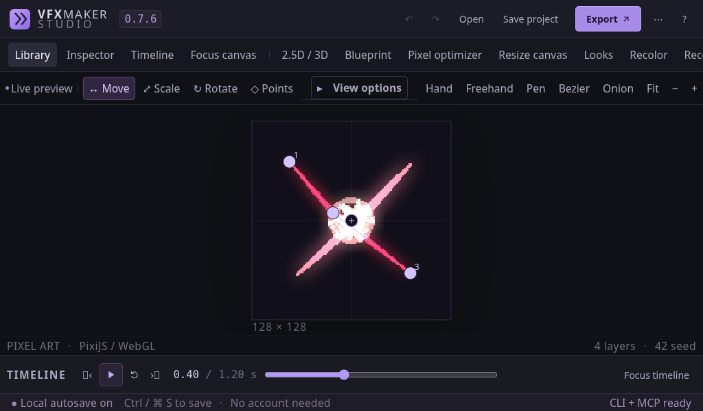

# Short-window authoring · 0.7.6

Actual Studio capture at 1024×600 with 1.3× text. Both desktop side-panel preferences
are enabled. The smaller window uses drawers and a folded timeline, leaving a
measured 289×289 drawing canvas. Returning to a larger window restores the saved
panels. Focus timeline / Restore canvas returns to the folded state.

[Capture measurements and browser error count](manifest.json).
[Workflow audit](../../docs/AUDIT_0.7.6.md) ·
[Regression scenarios](../../tests/e2e/audit.spec.ts).

This is an automated browser capture, not a human usability study.
