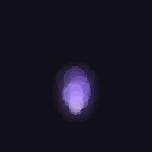
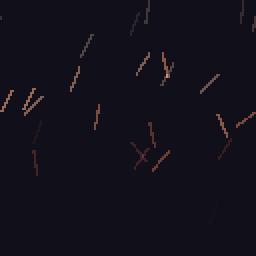

# Independent projects, direct colors and numeric QA

| Cool smoke: neutral particles with a purple gradient                    | Warm rain: directly set gradient                                      |
| ----------------------------------------------------------------------- | --------------------------------------------------------------------- |
|                                          |                                            |
| [Editable project](cool-smoke.vfx.json) · [RGBA QA](cool-smoke-qa.json) | [Editable project](warm-rain.vfx.json) · [RGBA QA](warm-rain-qa.json) |

These are real MCP-created projects and exports, using the same generic renderer
as Studio. The full run creates 16 projects from eight templates, sets gradients
and size controls, exports GIFs and Godot resources in two batches, runs reverse-order
RGBA parity at four explicit times for every project, and compares a saved baseline.
The manifest records 16 successful parity results and **one browser launch for
51 render requests**. Two representative results are included here.

[16-task recipe](tasks.json) · [Full run manifest](manifest.json) ·
[Smoke storyboard](cool-smoke-storyboard.png) · [Rain storyboard](warm-rain-storyboard.png)

```bash
npm run build
node scripts/verify-project-workflows.mjs /path/to/new-gallery
# Optional second argument: absolute path to an installed vfx-mcp.
```

The generated directory includes all 16 projects, GIFs, Godot atlases/resources,
QA reports, a protocol transcript and an HTML gallery. A second batch exports
the created projects to Godot using the actual revisions returned by creation.
This is a scripted protocol task with manually inspected images, not an external
model benchmark or a Godot editor import test.

The [before](benchmark-before.json)/[after](benchmark-after.json) benchmark uses
identical explicit storyboard times and preview requests through the official
MCP SDK, in separate processes on the same Linux machine. All seven image hashes
match across versions. Warm storyboard median: **1,765 → 307 ms**; warm preview
median: **1,203 → 44 ms**. Cold storyboard: **1,851 → 1,755 ms**. This measures
one machine/workload; separate CLI invocations still start cold. Reproduce with
`scripts/benchmark-agent.mjs SERVER_ENTRY FRESH_ROOT REPORT_JSON`.
