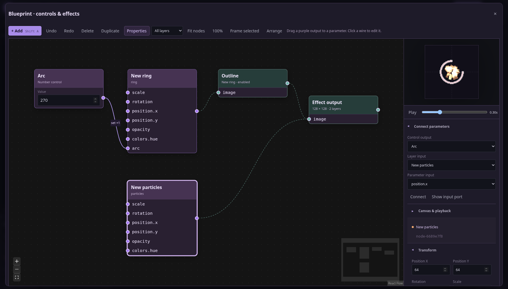
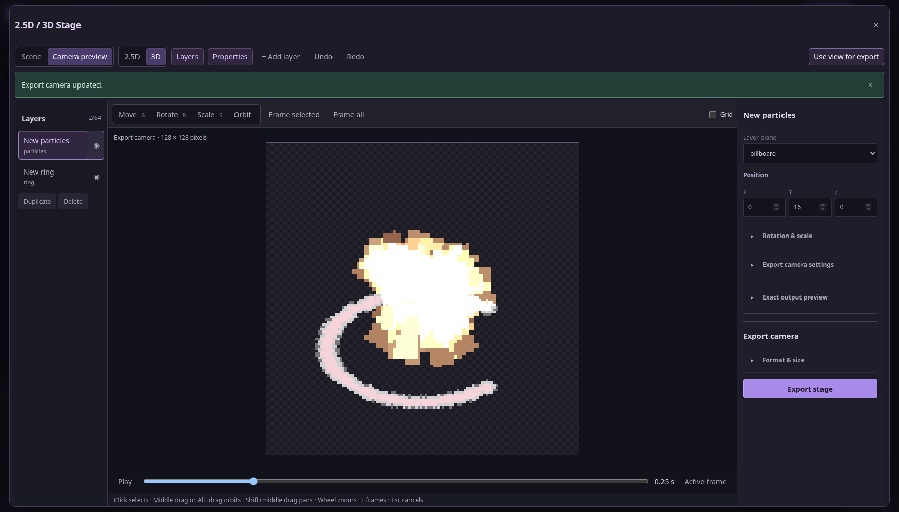

# Real UI workflow · 0.7.6

This project was made through Studio's actual buttons, fields and menus:
empty effect → Add Ring / Number / Outline / Particles → set Arc 270° → place
planes in 3D → frame the scene → align the camera → download a GIF.


[Open the saved editable project](tour.vfx.json). The
[manifest](manifest.json) records its project/GIF hashes and zero browser page
errors. This is a functional workflow example using the starter generators.

| Searchable Add | Editable graph |
| --- | --- |
|  |  |

| Scene editing | Exact camera output |
| --- | --- |
|  |  |

Reproduce with a built checkout:

```bash
node scripts/render-workspace-tour.mjs /path/to/new-tour
```

G/R/S select Stage tools; drag an axis handle. Middle drag or Alt+drag orbits,
Shift+middle pans, wheel zooms, F frames. Navigation leaves the output camera
alone until **Use view for export**. This example exports camera-baked frames
from effect planes, not a live mesh/particle scene.
